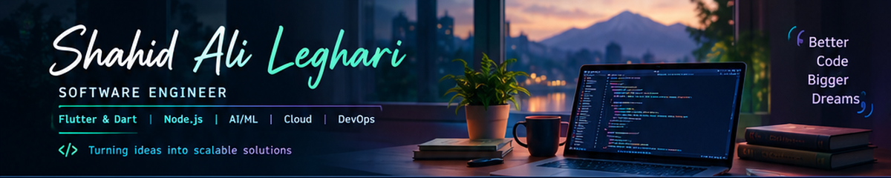
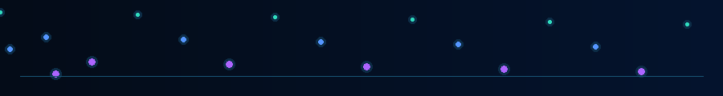
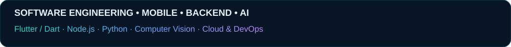

  

<h1 align="center">Hi, I'm Shahid Ali Leghari 👋</h1>

  <strong>Software Engineer · Flutter & Dart · Backend Development · AI/ML Explorer</strong>

  

  <a href="https://github.com/Shahidalileghari">GitHub</a> ·
  <a href="https://www.linkedin.com/in/shahid-ali-leghari/">LinkedIn</a> ·
  <a href="https://www.instagram.com/shahid_alilaghari/">Instagram</a>

---

## 👨‍💻 About Me

I'm a Software Engineering graduate from **Mehran University of Engineering and Technology (MUET), Jamshoro, Sindh, Pakistan**. I enjoy building practical software, developing mobile and backend applications, and exploring technologies that can solve real-world problems.

- 🎓 **Education:** B.E. in Software Engineering — MUET, Jamshoro
- 📱 **Core development:** Flutter, Dart, Node.js, Express.js, REST APIs
- 🤖 **Interests:** AI, Machine Learning, Deep Learning, Computer Vision, Generative AI
- ☁️ **Exploring:** Agentic AI, Cloud Computing, DevOps, and UI/UX
- 🤝 **Open to:** Software development opportunities and collaboration
- 📍 **Location:** Karachi, Pakistan

## 🧰 Technology Stack

  

### Languages
`Java` `Python` `JavaScript` `Dart` `SQL` `Bash`

### Mobile, Web & UI/UX
`Flutter` `Provider` `Riverpod` `HTML5` `CSS3` `React` `Bootstrap` `Responsive UI` `Figma`

### Backend & APIs
`Node.js` `Express.js` `REST APIs` `JWT` `Postman`

### Databases & Data
`PostgreSQL` `MySQL` `MongoDB` `SQLite` `NumPy` `Pandas` `Matplotlib`

### AI, ML, Deep Learning & Computer Vision
`Scikit-learn` `TensorFlow` `Keras` `PyTorch` `OpenCV` `CNNs` `Transformers` `Image Processing`

### Generative AI & Agentic AI — Areas of Exploration
`LLMs` `Prompt Engineering` `Embeddings` `RAG` `Tool Calling` `LangChain` `LangGraph` `LlamaIndex`

### Cloud, DevOps & Engineering
`AWS` `Azure` `Google Cloud` `Git` `GitHub` `GitHub Actions` `Docker` `Kubernetes` `Linux` `CI/CD`

> **Note:** This profile includes technologies I have used, encountered in projects, or am exploring. It does not imply expert-level proficiency in every tool.

## 💡 Engineering Skills

- Object-Oriented Programming and problem-solving
- Responsive UI implementation and application state management
- REST API development, integration, and error handling
- Database schema design and SQL/NoSQL data access
- Debugging, version control, and technical documentation
- MVC and Clean Architecture concepts
- Data preparation and computer vision project workflows
- Continuous learning and collaborative development

## 🚀 Project Highlights

### 🎓 EduCreators Hub
An educational application focused on helping learners access learning opportunities.

### 🌊 HydroScan — Final Year Project
An academic project exploring water-related analysis using computer vision, data processing, and geospatial technologies.

**Technologies:** Python, Streamlit, OpenCV, Pandas, TensorFlow, Google Earth Engine.

### 📱 Flutter Applications
Projects exploring UI development, state management, and features such as calculators, contact management, quotes, and a lottery game.

### ☕ Java Applications
Projects exploring Java fundamentals and desktop interfaces, including a Snake game, chat application, calculator, and encoding/decoding utility.

### 🌐 Personal Portfolio
A responsive website presenting my education, skills, and software projects.

**Technologies:** HTML, CSS, JavaScript, GitHub Pages.

➡️ **[Explore my repositories](https://github.com/Shahidalileghari?tab=repositories)** for source code and project details.

## 📊 GitHub Statistics

  
  

*Note: Statistics cards are hosted by an external service and may occasionally be unavailable. The local banner and animated GIF do not depend on external image services.*

## 🌱 Current Learning Goals

- Strengthen software design, testing, and maintainability practices
- Build reliable mobile applications and backend APIs
- Develop practical understanding of Machine Learning and Computer Vision
- Explore LLM applications, RAG, and Agentic AI workflows
- Learn cloud deployment, containers, and CI/CD fundamentals

## 🌐 Connect With Me

- **GitHub:** [@Shahidalileghari](https://github.com/Shahidalileghari)
- **LinkedIn:** [Shahid Ali Leghari](https://www.linkedin.com/in/shahid-ali-leghari/)
- **Instagram:** [My Instagram](https://www.instagram.com/shahid_alilaghari/)
- **Portfolio:**https://shahidalileghari.github.io/shahid-portfolio/ .
- **Email:**shahidalileghari2021@gmail.com.

---

  <strong>Thanks for visiting my profile — let's build something meaningful!</strong>

<em>Learning continuously. Building thoughtfully. Improving with every project.</em>

